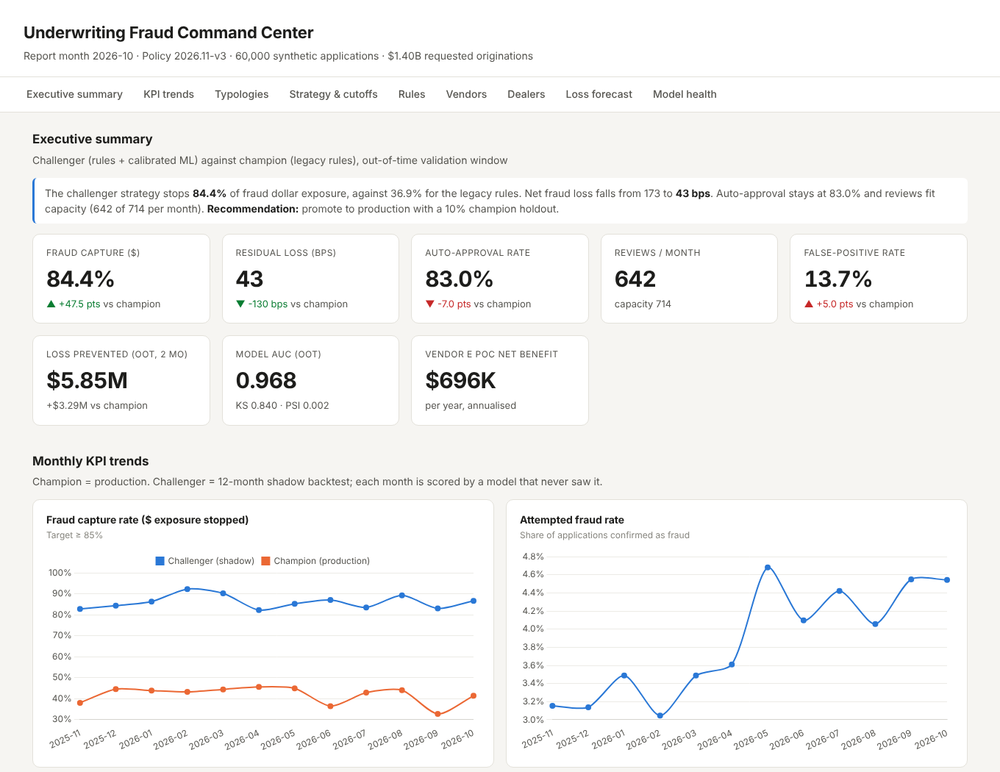

# Auto Lending Underwriting Fraud: Analytics, Risk & Strategy Prototype

**A working prototype of the fraud analytics, risk and strategy function for a dealer-channel auto lender.** It covers fraud decisioning rules, ML fraud scoring, cutoff optimisation, KPI governance, third-party vendor evaluation, loss forecasting and executive reporting. The pipeline runs end to end on 60,000 fully synthetic auto-loan applications.

Built as a portfolio piece for the **Director, Fraud Analytics, Risk & Strategy (Auto Finance / Lending)** role, reporting to the CFO.

[](https://codespaces.new/atlasse71/auto-fraud-risk-strategy?quickstart=1) [](https://colab.research.google.com/github/atlasse71/auto-fraud-risk-strategy/blob/main/notebooks/quickstart.ipynb) [](https://github.com/atlasse71/auto-fraud-risk-strategy/actions/workflows/ci.yml)

**[▶ Live dashboard](https://atlasse71.github.io/auto-fraud-risk-strategy/)** · **[📄 Monthly CFO / Credit Committee report](reports/monthly_fraud_report_2026-10.md)** · **[📘 Strategy playbook](playbook/)**



---

## Results at a glance (out-of-time validation, synthetic data)

| | Champion (legacy rules) | **Challenger (rules + calibrated ML)** |
|---|---|---|
| Fraud $ captured before funding | 36.9% | **84.4%** |
| Net fraud loss (bps of originations) | 173 | **43** |
| Auto-approval rate | 90.0% | **83.0%** (floor ≥ 80%) |
| Manual reviews / month | 476 | **642** (capacity 714) |
| Total cost: loss + friction + ops (2 months) | $4.52M | **$1.49M** |
| Synthetic-ID / straw-buyer / income / app-fraud capture | 52% / 14% / 17% / 54% | **91% / 70% / 84% / 86%** |

- **ML fraud model:** OOT AUC **0.968**, KS **0.84**, score PSI ≈ 0.00, isotonic-calibrated.
- **Loss forecast:** about **$13.8M** of fraud losses avoided over the next 6 months under the base scenario.
- **Emerging vendor POC (consortium identity graph):** **≈12× ROI**, with the largest lift on straw buyers. Recommendation: 60-day shadow integration.
- **Vendor scorecard:** three incumbents renewed (one with an SLA remediation plan). One vendor adds no incremental value on top of the others and is recommended for **replacement or high-risk-only tiering**.

> All data is synthetic and generated in code. No real consumer data is used, and vendor names are fictional archetypes. Every number above is reproduced by `python run_pipeline.py`.

---

## How the job description maps to this repo

| Role responsibility | Where it's demonstrated |
|---|---|
| Ensure underwriting blocks **synthetic identities, straw buyers, income misrepresentation, application fraud** before funding | Typology-specific data signatures ([`data_generator.py`](src/fraudlab/data_generator.py)), [control matrix](playbook/FRAUD_TYPOLOGY_CONTROLS.md), typology capture in the report and dashboard |
| **Design, implement and optimise automated fraud decisioning rules and risk cutoffs** in the LOS | Versioned policy file [`config/decision_rules.yaml`](config/decision_rules.yaml); [`rules_engine.py`](src/fraudlab/rules_engine.py) (DECLINE > REVIEW > STIP > APPROVE with reason codes); [`strategy.py`](src/fraudlab/strategy.py) cutoff optimisation on expected cost under review-capacity and auto-approval constraints; [LOS integration design](playbook/LOS_INTEGRATION.md) |
| **Establish KPIs:** capture rates, auto-approval, manual review queues, false-positive friction | [KPI framework](playbook/KPI_FRAMEWORK.md) with targets and escalation triggers; [`kpis.py`](src/fraudlab/kpis.py); SQL `monthly_kpis` and `review_queue_sla` |
| **Oversee third-party data providers; evaluate emerging identity intelligence** | [`vendors.py`](src/fraudlab/vendors.py): leave-one-vendor-out incremental lift, ROI, overlap/redundancy and SLA scorecard; time-ordered retro POC of a new consortium vendor; [vendor governance framework](playbook/VENDOR_GOVERNANCE.md) |
| **Deep-dive quantitative analysis with SQL, Python and AI tools** on application and bureau data | [`sql/`](sql/): analytics-mart schema plus 8 investigation and KPI queries (synthetic-ID candidates, phone-ring link analysis, straw-buyer dealer z-scores, vendor decile lift, reason-code effectiveness), executed on every run; Python analytics in `src/fraudlab/` |
| **Work with Data Science and Engineering to build, test and deploy ML fraud models** | [`model.py`](src/fraudlab/model.py): gradient boosting with OOT validation, calibration, PSI, permutation importance and shadow backtest; [model governance (SR 11-7)](playbook/MODEL_GOVERNANCE.md); 19 unit tests plus CI |
| **Present monthly fraud trends, vendor performance and underwriting loss forecasts** to the executive team and credit committees | Auto-generated [monthly report](reports/monthly_fraud_report_2026-10.md) with decisions requested; [`forecast.py`](src/fraudlab/forecast.py) base / adverse / severe scenarios; interactive [dashboard](docs/index.html) |
| Strong understanding of **auto lending risk factors and origination systems** | Deal-structure features (LTV, PTI, DTI, down payment, term, vehicle-to-income), dealer-channel dynamics (re-submissions, dealer collusion), thin-file and no-file handling with bank-data income verification, [LOS flow](playbook/LOS_INTEGRATION.md) |

---

## Architecture

```
                ┌──────────────────────┐
                │ data_generator.py    │  60k synthetic dealer-channel apps, 12 months
                │ (fraud typologies,   │  bureau · bank-data income · deal · device · dealer
                │  vendor signals)     │  vendors A–D + emerging vendor E (POC sample)
                └──────────┬───────────┘
          ┌────────────────┼──────────────────────────────┐
          ▼                ▼                              ▼
 rules_engine.py      model.py                      sql/ (SQLite mart)
 policy YAML →        GBM + isotonic calibration    schema + KPI &
 DECLINE/REVIEW/      OOT validation, PSI,          investigation queries
 STIP/APPROVE         importance, shadow backtest
          └───────┬────────┘
                  ▼
          strategy.py  champion vs challenger · $ economics · cutoff grid (capacity-constrained)
                  ▼
     kpis.py · vendors.py · forecast.py
                  ▼
          report.py → reports/monthly_fraud_report_YYYY-MM.md  +  docs/index.html (dashboard)
```

## Quick start

**One click, nothing to install:**
- **Codespaces** (button above): dependencies install automatically. In the terminal, run `python run_pipeline.py`, then `python -m http.server 8000 -d docs` to open the dashboard.
- **Colab** (button above): *Runtime → Run all* runs the pipeline, shows the results, and includes a "change a cutoff and re-run" exercise.

**Locally** (Python 3.10+):

```bash
pip install -r requirements.txt
python run_pipeline.py        # ~1 min: generates data, trains, scores, writes report + dashboard
python -m pytest -q           # 19 tests
open docs/index.html          # self-contained dashboard (works offline)
```

## Repository layout

| Path | Contents |
|---|---|
| `config/decision_rules.yaml` | Fraud decision policy: 17 rules across 5 typology families, ML cutoffs, review capacity, STIP assumptions |
| `src/fraudlab/` | Data generator, rules engine, ML model, strategy economics, KPIs, vendor analytics, forecast, report builder |
| `sql/` | Analytics-mart DDL and named KPI / investigation queries |
| `outputs/` | Every analysis table as CSV, plus `results.json` |
| `reports/` | Monthly executive fraud report for the CFO and Credit Risk Committee |
| `docs/index.html` | Interactive dashboard (published via GitHub Pages) |
| `playbook/` | Typology control matrix, KPI framework, vendor governance, model governance, LOS integration, 90-day plan |
| `notebooks/quickstart.ipynb` | Colab walkthrough: run, inspect results, tune a cutoff |
| `tests/` | Unit and integration tests (data integrity, rule hierarchy, NaN safety, model performance, SQL execution) |

## Methodology notes

- **Realistic difficulty.** Fraud records are "camouflaged": each attribute is replaced, with a probability scaled by the fraudster's sophistication, with values from a legitimate applicant. About 12% of fraud is fully clean, and 3% of good applicants share fraud-like traits (for example, recent immigrants with new phones). This produces realistic overlap, false positives and an imperfect ceiling.
- **Economics drive the cutoffs.** Cost = undetected fraud loss + lost profit on good customers who abandon after a decline, review or STIP + analyst review cost. The cutoff is chosen to minimise that cost, subject to review capacity and an auto-approval floor of at least 82%.
- **Incremental value, not standalone value.** Each vendor is judged by how much capture is lost when it is removed and the model is retrained. Results are averaged over seeds and measured at a fixed review rate, so the comparison is capacity-neutral.
- **Honest reporting.** The report flags off-target KPIs (for example, review-queue hit rate) and names the rules causing them, instead of only showing wins.
